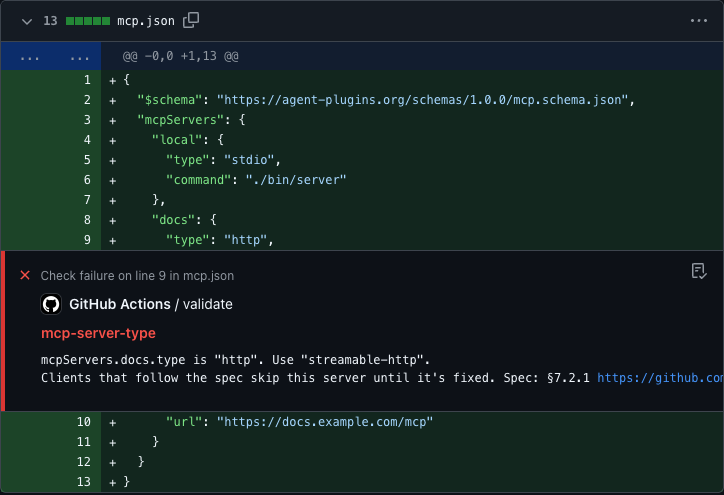
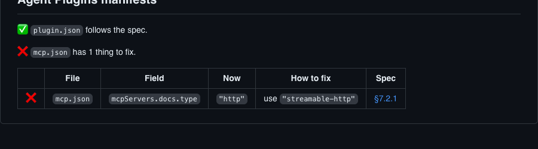

# agent-plugins-validate

[](https://github.com/rbadillap/agent-plugins-validate/actions/workflows/gate.yml)
[](https://github.com/rbadillap/agent-plugins-validate/releases/latest)

**Make sure your Agent Plugin actually loads, before anyone installs it.**

An Agent Plugin is a package of skills and MCP servers that AI clients load, described by a `plugin.json` and an `mcp.json`. This GitHub Action checks both against the [Agent Plugins specification](https://github.com/agentplugins/agent-plugins-spec/blob/v1.0.0/spec/1.0.0.md). When something's wrong, it tells you exactly what, and how to fix it, right in your pull request.

## Get started in one minute

Add this file to your repository as `.github/workflows/agent-plugins.yml`:

```yaml
name: agent-plugins
on: [push, pull_request]
permissions:
  contents: read
jobs:
  validate:
    runs-on: ubuntu-latest
    steps:
      - uses: actions/checkout@3d3c42e5aac5ba805825da76410c181273ba90b1 # v7.0.1
        with:
          persist-credentials: false
      - uses: rbadillap/agent-plugins-validate@32d0b41fe1d3881049730c9120660298adcec37d # v1.0.0
```

That's it. No configuration, no tokens, no secrets.

## What you'll see

If something's wrong, a note appears on the exact line of your pull request:



> ❌ **mcp.json, line 9**
> mcpServers.docs.type is "http". Use "streamable-http".
> Clients that follow the spec skip this server until it's fixed. Spec: §7.2.1 https://github.com/agentplugins/agent-plugins-spec/blob/v1.0.0/spec/1.0.0.md#721-discovery-and-configuration

And the run's summary gives you the full picture:



> **Agent Plugins manifests**
>
> ✅ `plugin.json` follows the spec.
>
> ❌ `mcp.json` has 1 thing to fix.
>
> | | File | Field | Now | How to fix | Spec |
> |---|---|---|---|---|---|
> | ❌ | `mcp.json` | `mcpServers.docs.type` | `"http"` | use `"streamable-http"` | [§7.2.1](https://github.com/agentplugins/agent-plugins-spec/blob/v1.0.0/spec/1.0.0.md#721-discovery-and-configuration) |

When everything is right, the check turns green and the summary simply says so: "Both manifests follow the Agent Plugins spec (1.0.0)."

## What it checks

Every rule cites a section of the spec. The most common ones, by file:

| File | Rule | Level | What it checks |
|---|---|---|---|
| `plugin.json` | `required-fields` | error | `name` is there |
| `plugin.json` | `plugin-name` | error | `name` is lowercase kebab-case, up to 64 characters |
| `plugin.json` | `field-type` | error | metadata fields have the right type |
| `plugin.json` | `unknown-field` | warning | no top-level field the spec doesn't define |
| `plugin.json` | `version-semver` | notice | `version` is a Semantic Versioning string |
| `mcp.json` | `mcp-top-level` | error | `mcpServers` is there |
| `mcp.json` | `mcp-server-type` | error | `type` is `stdio`, `streamable-http` or `sse` |
| `mcp.json` | `mcp-server-fields` | error | each server has the fields of its type |
| `mcp.json` | `mcp-url` | error | `url` is an absolute `http` or `https` URL, without credentials |
| `mcp.json` | `mcp-env-name` | warning | no `env` name with `=` in it |
| both | `json-syntax` | error | the file is valid JSON |
| both | `schema-version` | error | `$schema` names a supported version |

All the rules, with what each one checks and its spec section, are in [docs/rules.md](docs/rules.md).

### Levels

Levels follow what the spec says a client does with the problem:

- **Error:** a client rejects the plugin, turns off its MCP servers, or skips a server. Fails the check.
- **Warning:** the spec requires it, but a client reports the problem and keeps loading, such as an unknown top-level field in `plugin.json` ([§5.2](https://github.com/agentplugins/agent-plugins-spec/blob/v1.0.0/spec/1.0.0.md#52-manifest-object)). Doesn't fail.
- **Notice:** something the spec recommends (SHOULD) but doesn't require, such as a Semantic Versioning `version` ([§10.2](https://github.com/agentplugins/agent-plugins-spec/blob/v1.0.0/spec/1.0.0.md#102-plugin-versions)). Doesn't fail.

## Questions you might have

<details>
<summary><b>Does it send my code anywhere?</b></summary>

No. It runs inside your own workflow, and the official spec files are bundled with it, so it never needs to download anything. See [Permissions](#permissions) for the one opt-in exception.

</details>

<details>
<summary><b>Will it suddenly break my CI?</b></summary>

No. Only real problems fail the check: the ones that stop your plugin, or one of its MCP servers, from loading. Suggestions from the spec appear as notes and never fail anything. When a new check is added, it starts as a warning and only becomes an error in a new major version, so `@v1` never breaks on its own.

</details>

<details>
<summary><b>Do I need to give it a token or a secret?</b></summary>

No. Reading your files is all it needs. If you turn on issues, it uses the token GitHub already gives every workflow, and you don't set anything.

</details>

<details>
<summary><b>My plugin isn't at the root of my repository.</b></summary>

Tell it where your `plugin.json` is. It checks the `mcp.json` next to it automatically:

```yaml
      - uses: rbadillap/agent-plugins-validate@32d0b41fe1d3881049730c9120660298adcec37d # v1.0.0
        with:
          manifests: plugins/*/plugin.json
```

</details>

<details>
<summary><b>Can it warn me when something breaks on my main branch?</b></summary>

Yes, if you want it to. Turn on `open-issues`, and when a manifest that used to be fine breaks on your default branch, you get one issue for it. When you fix it, the issue closes itself. It never opens the same issue twice, and it never opens issues for problems you already had. [How to turn it on](#open-issues-on-regressions-optional)

</details>

<details>
<summary><b>Can my scripts or an AI agent read the results?</b></summary>

Yes. Every run writes a JSON report with one entry per finding, and the `report` output holds its path. [The report](docs/report.md)

</details>

---

## Reference

### Inputs

| Input | Default | What it does |
|---|---|---|
| `manifests` | `plugin.json`<br>`mcp.json` | Files or patterns to check, one per line, from the repository root. Only files named `plugin.json` or `mcp.json` are read. The `mcp.json` next to each `plugin.json` is always checked with it, and a missing one is fine. **A line that matches no file fails the step**, with a message naming that line. |
| `open-issues` | `false` | Open an issue when something breaks on your default branch. [How](#open-issues-on-regressions-optional) |
| `token` | `${{ github.token }}` | Used only when `open-issues` is on. You don't need to set it. |

### Outputs

| Output | Example | What it means |
|---|---|---|
| `valid` | `true` | No errors. Notices and warnings don't change it. |
| `findings` | `2` | Everything found, at any level. |
| `report` | `/home/runner/work/_temp/agent-plugins-validate/<step>/report.json` | Path to every finding as JSON. |

```yaml
      - id: manifests
        uses: rbadillap/agent-plugins-validate@32d0b41fe1d3881049730c9120660298adcec37d # v1.0.0
      - if: always() && steps.manifests.outputs.findings != '0'
        run: echo "Something to look at, see the summary of this run"
```

The format of each finding, and the [JSON Schema](docs/report.schema.json) of the report, are in [docs/report.md](docs/report.md).

### Permissions

This is the one place for what the Action can reach.

| Permission | When | Why | Without it |
|---|---|---|---|
| `contents: read` | Always | `actions/checkout` fetches your code. With `open-issues`, it also reads the previous manifests. | A private repository can't be checked out. No regression can be proven. |
| `issues: write` | Only with `open-issues` | Open, update and close its own issues, and create its label. | A warning says so. Results don't change and nothing fails. |

- **No network.** With `open-issues` off, the Action makes no HTTP, DNS or socket use at all. With it on, it talks only to GitHub's API, to read the previous version of your manifests and to manage its own issues. No telemetry. The schemas are bundled, so nothing is downloaded.
- **No secrets.** It reads none and has no token of its own. With `open-issues` on, it uses the `token` input, which defaults to the workflow's `GITHUB_TOKEN`.
- **Small writes.** The step outputs, the job summary, the JSON report in the runner's temporary directory and, only if you opt in, its own issues. It never comments on pull requests, pushes commits or touches issues it didn't open.
- **Your files.** It reads only files named `plugin.json` or `mcp.json` inside your checkout, never follows a link out of it, and never runs what it reads. What your manifests contain is treated as untrusted text in annotations, summaries and issues.

It has no opinion on how your MCP servers authenticate or confirm writes. The spec leaves those to the client.

### Open issues on regressions (optional)

<a id="issues"></a>

Issues are off by default. To turn them on, give the job `issues: write` and set `open-issues`:

```yaml
name: agent-plugins
on:
  push:
permissions:
  contents: read
  issues: write
concurrency:
  group: agent-plugins-validate-${{ github.ref }}
  cancel-in-progress: false
jobs:
  validate:
    runs-on: ubuntu-latest
    steps:
      - uses: actions/checkout@3d3c42e5aac5ba805825da76410c181273ba90b1 # v7.0.1
        with:
          persist-credentials: false
      - uses: rbadillap/agent-plugins-validate@32d0b41fe1d3881049730c9120660298adcec37d # v1.0.0
        with:
          open-issues: true
```

- **Only on your default branch**, whatever its name. On other branches and on pull requests it does nothing.
- **Only real regressions:** a check that passed at the commit before the push and fails now. No proof, no issue.
- **One issue per problem**, never repeated, with the `agent-plugins-validate` label. It only ever touches issues it opened.
- **Closed by the fix.** When the check passes again, the issue closes with a comment naming the commit.
- **Errors and warnings only.** Notices never open issues.

How it decides, what it tracks and its limits are in [docs/issues.md](docs/issues.md).

### Pinning and updates

| Pin | Example | You get |
|---|---|---|
| Commit SHA (recommended) | `rbadillap/agent-plugins-validate@32d0b41…cec37d # v1.0.0` | Exactly the code you reviewed. A SHA can't be moved to point at different code. |
| Major tag | `rbadillap/agent-plugins-validate@v1` | Every v1 fix without touching your workflow. The `v1` tag moves with each release. |

To keep a SHA up to date, let Dependabot open the pull requests. It updates the SHA and the version comment together. Add this to `.github/dependabot.yml`:

```yaml
version: 2
updates:
  - package-ecosystem: github-actions
    directory: /
    schedule:
      interval: weekly
```

The Marketplace's "Use latest version" button gives a tag, not a SHA. Replace the tag with the commit it points to, as above.

Every release is immutable and has a build attestation. To check that the `dist/index.js` you run was built by this repository's release workflow, download it from the tag you use and verify it ([how releases are made](docs/releasing.md)):

```bash
gh attestation verify dist/index.js --repo rbadillap/agent-plugins-validate
```

A new check arrives as a `warning` (or `notice`) in a minor release, and becomes an `error` only in the next major release.

### Troubleshooting

<details>
<summary><b><code>manifests line 1: "plugin.json" matched no file</code></b></summary>

A line of `manifests` matches nothing in the checkout. The line is quoted in the message. Check its spelling and that the path starts at the repository root, and that `actions/checkout` runs before the Action. Only files named `plugin.json` or `mcp.json` can match.

</details>

<details>
<summary><b><code>Issues: on, but the token can't write issues. Add issues: write to the job's permissions.</code></b></summary>

`open-issues` is on, and the job's token can't write issues. Add `issues: write` under `permissions:` of the job or the workflow. Nothing else changes, and the check doesn't fail for it.

</details>

<details>
<summary><b><code>Issues: skipped, GitHub's API rate limit was reached. They'll catch up on the next push.</code></b></summary>

GitHub's API limit was reached during this run. The issues for it are skipped, and the next push to the default branch catches up. Your results aren't affected.

</details>

### Specification and bundled schemas

The checks follow [Agent Plugins 1.0.0](https://github.com/agentplugins/agent-plugins-spec/blob/v1.0.0/spec/1.0.0.md). The official schemas ship inside this Action, in [`schemas/`](schemas/), under their own Apache-2.0 license ([notice](schemas/1.0.0/NOTICE.md), [license text](schemas/1.0.0/LICENSE)). A manifest that declares a version this Action doesn't support gets one finding saying so, never a guess.

## License

[MIT](LICENSE). The bundled schemas keep their Apache-2.0 license.
